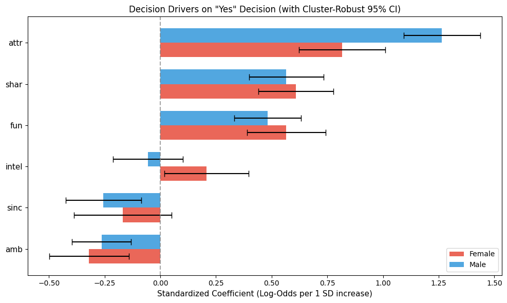

# Speed Dating: popularity, selectivity or compatibility?

> Product analytics case: how much of a match comes from popularity, selectivity or compatibility?
> Speed dating data, Python/pandas, statsmodels, scikit-learn, bootstrap, Gini.

**Status:** v1 complete. The analysis is done; the product A/B test is designed but not run.

## Business question

**Decision:** should a recommender rank profiles by the predicted probability of a
*mutual* match, instead of optimizing only for the viewer's own interest?

**Questions:**
1. How unequally are "yes" decisions distributed across participants?
2. Does a "yes" convert into a match less often for generous users, and is that about selectivity or about popularity?
3. What predicts a mutual match out of sample: popularity, reply propensity, or pair-level compatibility?

## Hypotheses and verdicts

- **H1 (inequality):** received "yes" decisions are unequally distributed beyond sampling noise. **Supported (moderate).**
- **H2 (selectivity):** the share of "yes" answers that turn into a match declines as a participant's own yes-rate grows. **The raw pattern holds, but it is mostly explained by popularity.**
- **H3 (compatibility):** pair-level features known before the date (age gap, interest similarity, same race, same goal) add out-of-sample ranking value beyond candidate popularity and reply propensity, with a decision threshold of +0.02 per-user AUC. **Not supported.**

**What would change my mind:** if pair-level features gave a lift of at least +0.02 per-user AUC over the popularity + reply-propensity baseline, the recommendation would include compatibility features. They did not.

## Data

Speed dating experiment (Fisman & Iyengar, Columbia Business School, 2002-2004):
8,378 rows (each date appears twice, once per participant), 551 participants, overall match rate ≈ 16.5%.
Download instructions: see [`data/README.md`](data/README.md). Raw data is not stored in this repo.

## Key findings

### H1: attention is unequal beyond noise, but not extreme


- Gini of received yes-rate: women **0.286** (95% CI 0.262-0.309), men **0.351** (0.321-0.379). The 95th percentile of a wave-aware random-allocation null is 0.205 and 0.257.
- The top 20% of participants account for **34.2%** (women) and **38.3%** (men) of all received yes-rate (null 95th percentile: 30.3% and 33.3%).
- Speed dating is a closed round-robin, so inequality here is likely lower than in a feed-based app. The magnitude does not transfer directly.

### H2: conversion falls with generosity, mostly through popularity

Pooled "yes" to match conversion by selectivity quintile (within gender):

| Selectivity quintile | Women: yes-rate → conversion | Men: yes-rate → conversion |
| :--- | :--- | :--- |
| Very selective | 6.2% → 55.9% | 13.9% → 46.8% |
| Selective | 22.3% → 57.8% | 32.7% → 44.0% |
| Moderate | 36.3% → 53.2% | 45.3% → 41.3% |
| Generous | 49.8% → 41.2% | 61.8% → 33.3% |
| Spam-like | 72.2% → 38.5% | 87.2% → 26.2% |

A binomial GLM with both selectivity and popularity shows that the selectivity effect is small once popularity is controlled for:
women −0.11 (p = 0.55), men −0.33 (p = 0.048); popularity ≈ 5 in both (log-odds per unit of rate). A match requires the partner's "yes",
so conversion is closely tied to how popular the sender is. The "selectivity paradox" is largely a popularity effect.

### H3: ranking evaluation

Setup: 4,074 unique dates, 274 male viewers. Candidate popularity (`pop_j`) and reply propensity (`sel_j`) are computed from training viewers only
(out-of-fold for training rows), 5-fold grouped CV by viewer, per-viewer ranking of his dates.
Models: gradient boosting. A predicts the viewer's own "yes"; B predicts a mutual match.

| Model | Per-user AUC | Top-3 match rate |
| :--- | :--- | :--- |
| Random | - | 16.9% |
| A: viewer's own interest | 0.584 | 23.7% |
| B: mutual match | 0.641 | 25.5% |
| B without pair-level features | 0.651 | 25.9% |
| B without candidate reply propensity | 0.574 | 20.6% |

Paired per-viewer differences (95% CI):

| Comparison | Per-user AUC | Top-3 match rate |
| :--- | :--- | :--- |
| B vs A (exploratory) | +0.058 [+0.019, +0.097] | +0.018 [-0.013, +0.050] |
| Pair-level features (B vs B without them) | -0.009 [-0.035, +0.016] | -0.004 [-0.026, +0.019] |
| Candidate reply propensity (B vs B without it) | +0.067 [+0.036, +0.098] | +0.050 [+0.023, +0.077] |

- Pair-level features add no measurable value: the upper CI bound (+0.016) is below the +0.02 threshold.
- The ranking gain comes from the candidate's propensity to reply. Mutual-match ranking beats own-interest ranking on per-user AUC, but not distinguishably on top-3.

### Decision drivers (associations, not causes)



- Physical attractiveness is the strongest driver of a "yes" (standardized log-odds: women 0.82, men 1.26), followed by shared interests and fun (0.48-0.61).
- Negative coefficients for `sinc` and `amb` are conditional on the other ratings (collinearity), not evidence that these traits are disliked.
- These ratings are recorded together with the decision and are not available before a date, so they are not deployable features.

## Recommendation (provisional)

1. Include the candidate's likelihood to reply (response propensity) in ranking. It is the single component that adds out-of-sample value in this data.
2. Do not invest in profile-based pair compatibility features on this evidence.
3. The headline comparison (mutual-match vs own-interest ranking) is positive on per-user AUC and inconclusive on top-3, so validate it with an online A/B test.

## How I would test this in a product

- **Design:** randomize users. Control keeps the current ranking; treatment ranks by predicted interest × predicted reply probability.
- **Primary metric:** mutual matches per active user per week.
- **Guardrails:** concentration of received likes (Gini / top-20% share), share of new users with at least one match in the first 7 days, conversation rate after a match.
- **Sample size:** run a power analysis on the product's own baseline before launch.
- **Risks:** feedback loops that concentrate attention on popular profiles; cold-start users have no reply history, so a global prior is needed.

## Approach

- [x] Data audit: unit of analysis (each date appears in two rows), missing values, consistency of `match`, `dec`, `dec_o`
- [x] Popularity and selectivity per participant; Lorenz curve, Gini and top-20% share with bootstrap CI (resampling participants) against a wave-aware null model
- [x] Match precision vs yes-rate (H2) with a binomial GLM controlling for popularity
- [x] Decision drivers: standardized logit with participant-clustered standard errors
- [x] Ranking evaluation: in-fold candidate statistics, grouped CV by viewer, per-user AUC and top-3 match rate, ablations
- [x] Recommendation and limitations
- [ ] Online A/B test (designed, not run)

## Deviations from the initial plan

- The independence benchmark (observed match rate vs expected under independent decisions) was dropped: it cannot separate popularity from compatibility. It is replaced by out-of-sample ablations.
- Leave-one-out popularity/selectivity was replaced by in-fold candidate statistics, because leave-one-out encodings leak the label.
- The +0.02 threshold applies to the pair-level comparison only. The comparison of A and B, and the reply-propensity ablation, are exploratory.

## Limitations

- Heterosexual pairs only, Columbia graduate students, in-person 4-minute dates (not swipes), 2002-2004. Findings describe mutual-choice mechanics, not any specific app's users.
- Closed round-robin: everyone meets everyone, so there is no exposure or position bias. Inequality magnitudes and ranking gains do not transfer directly.
- Candidate statistics need interaction history. New users have none (cold start). Here they come only from other viewers in the same event.
- Pair-level features are limited to pre-date proxies (interest correlation and cosine similarity, age gap, same race, same goal). A null result does not rule out other forms of compatibility.
- Confidence intervals treat viewers as independent although they share candidates and waves, so they are likely slightly optimistic.
- Missing data: 220 of 8,368 rows (2.6%) are dropped for model features; match rate is similar (16.5% vs 17.3%).
- A single dataset, with no external validation.

## Repo structure

```
data/              how to get the data (raw data is not stored)
notebooks/         analysis notebook with outputs
reports/figures/   Lorenz curves, decision drivers
METHODOLOGY.md     feature selection, data dictionary, methods
requirements.txt
```

For a detailed breakdown of feature selection, methods and the data dictionary, see [METHODOLOGY.md](METHODOLOGY.md).
